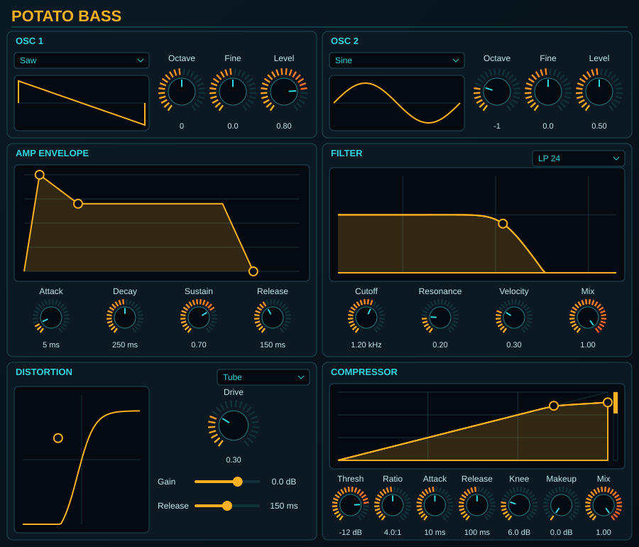

# Potato Bass

Windows 11 VST3 EDM bass synth built with JUCE 8 and CMake.

- Two oscillators sharing 20 band-limited wavetables
- Editable ADSR display, multi-mode filter with response display
- Oversampled distortion (Tube, Tape, Soft Clip, Hard Clip, Diode, Fold) and compressor with gain-reduction meter



## Get a build

Every push builds on GitHub Actions. Open the latest run under the Actions tab and download the `Potato-Bass-VST3-Windows` artifact. Copy `Potato Bass.vst3` to `C:\Program Files\Common Files\VST3\`.

## Build locally

Requires Visual Studio 2022 (Desktop C++) and CMake 3.22+.

```
cmake -B build
cmake --build build --config Release
```

The plugin is written to `build\PotatoBass_artefacts\Release\VST3\`.

## License note

JUCE is AGPL/commercial. A closed-source or commercial release needs a JUCE commercial license.
